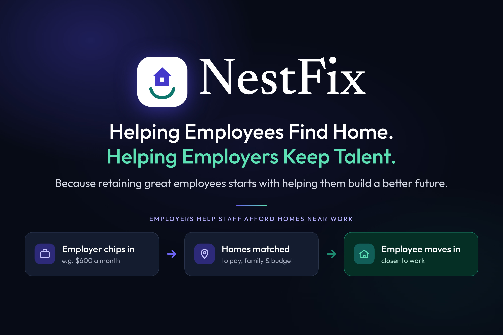

# Nestfix



Nestfix helps an employer put money toward housing and show each employee real rentals they can afford after that help. Listings come from Bright Data. Explanations come from Gemini.

The demo company is Harborlight Logistics. Five employees are loaded on first run. There is no password. Pick the employer desk or an employee view.

## Inspiration

NestFix started from a real tradeoff: live close to work, or live somewhere the rent fits. Near the job, a typical home can run about $3,200 a month. Farther out, rent drops toward $2,100, and the commute stretches toward an hour. NestFix is how an employer helps someone have both.

Harborlight Logistics is the story we built around. The company already knows what it is willing to pay toward housing. The employee still has to find a real place, see what they would actually pay after that help, and know whether the house is close to the office.

## What it does

NestFix is the desk for that decision. An employer adds a company, a workplace, and the people they want to keep, including how much housing help each person gets. An employee opens their own page and sees live rentals in that city, ordered so homes closer to the office come first when the rent still fits.

Each home shows the listed rent, what the company pays, and what is left:

\[
\text{net} = \text{listed rent} - \text{employer help}
\]

Help can be a monthly amount, a one-time grant spread over the year, or a percent of the rent. The card also shows photos of that home, a map, and the miles from the workplace. The longer page adds schools, hospitals, and transit, plus a box to ask about the home. The employer sees who has chosen a place, and what the company would pay.

## How we built it

NestFix is an app, built using FastAPI and SQLite that holds the company, the people, and the homes they have reviewed. React, Vite, and Tailwind are the desk they use. There is no login. An employer opens their team. An employee opens their own homes.

On first run the database loads Harborlight and five people in Austin, where the office is: 2100 E St Elmo Rd. Each person has a salary, a household, a commute limit, and a kind of help.

Finding homes calls Bright Data’s Zillow datasets for live rentals and Google Maps datasets for schools, parks, hospitals, and transit. Gemini writes the pros, cons, and the plain-language note for that specific person. Follow-up questions about a store or a school reuse a saved place when we already have it, and otherwise look it up and answer with the name, the address, and the miles.

Photos come from the listing itself. The listing card stays to the photo, the map, the price split, and the miles from the office. Nearby schools, hospitals, and transit stay on the detail page. The employer can change the workplace, and the next search prefers homes closer to that address.

## Challenges we ran into

Listing pages are collected as a dataset job. The photos, price, and address are ready when that job finishes, so the app keeps the same snapshot and reads it when the records are there.

A question about a grocery store or a school needs a name, an address, and the miles from the home. Those answers are saved and reused.

The gallery uses the listing’s own photos of the house. Schools, hospitals, and transit stay on the detail page.

Refreshing homes keeps earlier questions from blocking the new list. The workplace is stored on the company, and homes that fit the budget are ordered by miles from that office.

## Accomplishments that we're proud of

The number on the card is the rent a person would actually pay after the company helps. Three different kinds of employer help all land in that same split, and the company’s fixed monthly commitment adds up in the open:

\[
600 + 800 + \frac{4800}{12} + 1000 = 2800
\]

Maya, Priya, Luis, and Amina. Jordan’s 15 percent of rent sits on top of that once a home is chosen.

The homes are real listings, with the listing’s own photos, and they are ordered by distance to a workplace the employer can edit. Asking “how far is the closest grocery store?” comes back with a name, an address, and the miles. The same app is the employer desk, the employee desk, and the admin page for a new company.

## What we learned

A subsidy is not one number. A monthly amount is that amount. One-time help has to be spread across the months it is meant to cover. A percent of rent cannot be totaled until a home is chosen, because it depends on the rent.

We also kept the usual housing guideline, 30 percent of gross monthly pay:

\[
\text{budget} = 0.30 \times \frac{\text{annual salary}}{12}
\]

Distance to the workplace is the other half of the decision. With the office and the house both on a map, miles come from the haversine formula, where \(R\) is the Earth’s radius and \(\phi, \lambda\) are latitude and longitude:

\[
d = 2R \arcsin\sqrt{\sin^2\left(\frac{\Delta\phi}{2}\right) + \cos\phi_1\cos\phi_2\sin^2\left(\frac{\Delta\lambda}{2}\right)}
\]

Homes that still fit the budget are then ordered by that distance. For Maya, 5808 Ann Jene Ct is about 1.4 miles from Harborlight. Another house in Austin can be 17 miles from the same office. The budget can match while the commute does not.

## What's next for NestFix

The next step is a drive time from each house to the office, so a highway route and a city route can be compared on the clock.

A company should also be able to keep more than one workplace, and each person should be matched to the site they actually work at. After that: a sign-in so each employee only sees their own desk, and a map on the employer page of who can live within the commute they asked for.

## Setup

From the project root:

```bash
python3 -m venv .venv
source .venv/bin/activate
pip install -r requirements.txt
cp .env.example .env
```

Edit `.env` on your machine. That file stays off Git. The same two names are repository secrets for GitHub Actions:

- `GEMINI_API_KEY` — a Google AI Studio key. New keys start with `AQ.`. Older keys start with `AIza`.
- `BRIGHT_DATA_API_KEY` — a Bright Data API token.
- `BRIGHT_DATA_SERP_ZONE` and `BRIGHT_DATA_UNLOCKER_ZONE` — optional. If those zones exist, Nestfix searches with the SERP API and can enrich a page with Web Unlocker. Leave them blank to use Bright Data’s Zillow and Google Maps datasets, which do not need a zone name.

Frontend:

```bash
cd frontend
npm install
```

## Run

In one terminal, from the project root:

```bash
source .venv/bin/activate
uvicorn app.main:app --reload --port 8000
```

In another:

```bash
cd frontend
npm run dev
```

Open http://127.0.0.1:5173. API docs are at http://127.0.0.1:8000/docs.

## Bright Data

Nestfix calls Bright Data in this order:

1. **SERP API** (`POST https://api.brightdata.com/request`) when `BRIGHT_DATA_SERP_ZONE` is set or a serp zone is on the account. The query is a Google search for rentals in the employee’s city, bedroom count, and budget. A second query asks for schools, parks, hospitals, and transit.
2. **Web Unlocker** on the top listing URL when `BRIGHT_DATA_UNLOCKER_ZONE` is set. The markdown excerpt fills in a missing price when the snippet has one.
3. **Datasets API**, used when no SERP zone is available:
   - Zillow search dataset `gd_m71oxpvxwr113ehqg` with a rentals URL and `searchQueryState` (beds and max price).
   - If that returns too few rows, Zillow listing discovery `gd_lfqkr8wm13ixtbd8f5` (`House for rent` in the employee’s city). Those records include price, beds, address, schools, and walk/transit scores.
   - Google Maps dataset `gd_m8ebnr0q2qlklc02fz`, discovered by keyword for schools, parks, hospitals, and transit.

Calls are logged on the employee page under **Show Bright Data and Gemini log**, and in the `analysis_logs` table.

This project collects listings through the datasets API. Add zone names to `.env` to also use SERP and Web Unlocker.

## Gemini

`app/services/gemini_service.py` sends the employee (name, salary, family, city, contribution, notes) and the Bright Data rows. It asks for JSON: score, pros, cons, why this fits, an affordability paragraph, and a neighborhood summary. The affordability calculator asks Gemini for a short narrative as well.

Model default is `gemini-3.5-flash`. Nestfix can also try `gemini-3.5-flash-lite`, then `gemini-flash-lite-latest`. Override with `GEMINI_MODEL`.

## API

- `POST /employers/upload-employees` — CSV upload or JSON list
- `POST /housing/generate-options/{employee_id}` — Bright Data search, Gemini write-up, stored options
- `GET /employees/{employee_id}/options` — matches, net price included
- `POST /employees/{employee_id}/select-option`
- `POST /employees/{employee_id}/affordability-calc`
- `GET /employers/{employer_id}/selections-summary`

`employee_id` may be the internal id or the external id, such as `HL-1042`.

SQLite file: `nestfix.db` in the project root. Delete it to reseed Harborlight.
